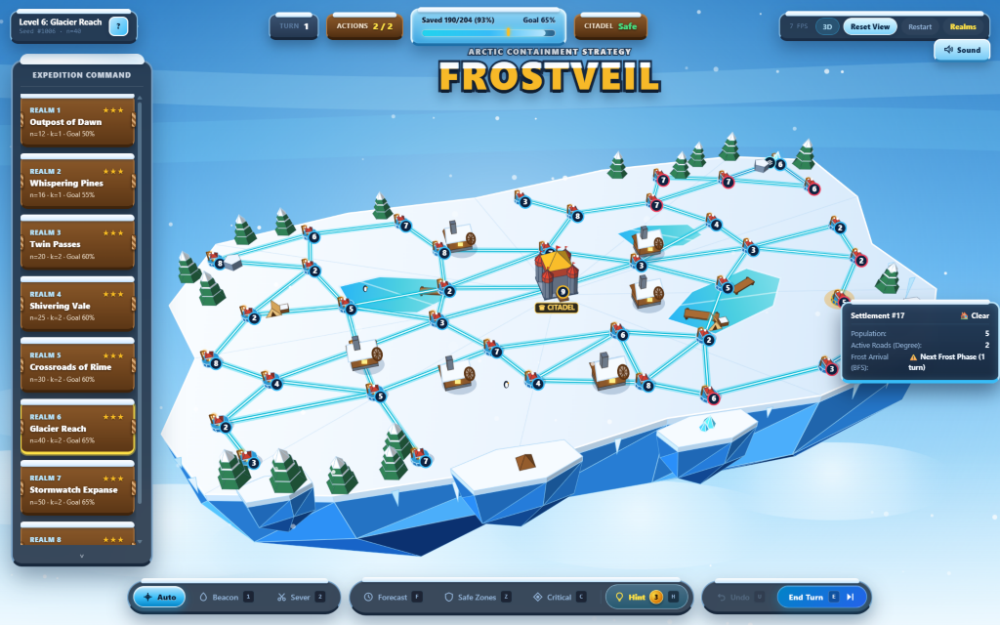

# Frostveil

A 2D turn-based strategy game that runs in the browser. A magical frost creeps across a realm of snow-bound
settlements connected by roads. You are the **Warden**: light beacons and sever roads to stop the frost, save as
much population as possible, and always keep the **Citadel** safe.

Frostveil is a variant of the **Firefighter Problem** (NP-hard on general graphs) and the group project for
**Quiz 2** of *Design & Analysis of Algorithms (EF234405)*. It implements BFS, iterative DFS / connected components,
iterative Tarjan articulation points and bridges, Kruskal with union-find, greedy strategies and a brute-force
search, and it benchmarks all of them.



<!-- docs/img/screenshot.png is added by Member B (UI). -->

## How to play

1. Each turn you have `k` actions (1 or 2, depending on the level) before the frost moves.
2. **Light Beacon** on a clear settlement: it can never be frosted and never passes frost on. **Sever Road**: the road is removed.
3. You can undo actions (in reverse order) until you end your phase.
4. When you end your phase, every frosted settlement frosts all clear neighbors along remaining roads (one step).
5. The game ends when the frost can no longer spread. Saved population counts every settlement that is not frosted.
6. You win if the Citadel is not frosted and the saved percentage reaches the level's target; 1 to 3 stars depend on how you compare with the built-in strategies.

## Run locally

Requirements: Node.js 20 or newer (only for tests and benchmarks) and Python 3 (only for the static server).

```
npm run serve
```

Then open `http://localhost:8080`. The game is made of static files, so any static server works.

## Tests and benchmarks

```
npm test                          # unit tests (node --test)
npm run bench                     # full benchmark run, writes bench/results/
node bench/run.js --quick         # fast smoke test, writes bench/results/quick/
node bench/run.js --only=runtime  # runtime | strategies | bruteforce
node bench/run.js --charts        # redraw SVG charts from the JSON in bench/results/
node bench/tables.js              # Markdown tables from the JSON in bench/results/
```

The in-browser benchmark (a lighter version with live charts) is at `http://localhost:8080/bench/bench.html`
after `npm run serve`.

## Deploy to GitHub Pages

1. Push the repository to GitHub (all three branches merged into `main`).
2. Open **Settings -> Pages**.
3. Under **Build and deployment**, choose **Deploy from branch**.
4. Select branch `main` and folder `/ (root)`, then save.
5. After a minute the game is served at `https://<user>.github.io/<repo>/`. All paths in the code are relative, so the sub-path works.

## Project structure

```
index.html               game page (Member B)
css/                     styles (Member B)
src/core/                pure game logic and algorithms (Member A)
src/ui/                  canvas rendering and input (Member B)
tests/                   unit tests (Member A)
bench/                   benchmarks, charts and results (Member C)
  run.js                 Node benchmark runner (npm run bench)
  suite.js               the three benchmarks, shared by run.js and bench.html
  graphs.js, stats.js    benchmark graph generator, statistics helpers
  core.js                the only file in bench/ that imports the core
  charts.js, bench.html  hand-written canvas / SVG charts and the in-browser benchmark
  tables.js              Markdown tables generated from bench/results/
  results/               generated JSON, CSV, SVG and environment files
docs/                    CONTRACT.md, ALGORITHMS.md, UI_NOTES.md, DESIGN.md, EVALUATION.md, REPORT.md
```

## Documentation

- [docs/DESIGN.md](docs/DESIGN.md) - problem, graph model, rules, algorithm choice, pseudocode, complexity, architecture
- [docs/EVALUATION.md](docs/EVALUATION.md) - benchmark setup, runtime, strategy comparison, optimality gap, brute-force scaling
- [docs/REPORT.md](docs/REPORT.md) - the assembled submission report
- [docs/CONTRACT.md](docs/CONTRACT.md) - the core API contract (Member A)
- [docs/ALGORITHMS.md](docs/ALGORITHMS.md) - algorithm details (Member A)
- [docs/UI_NOTES.md](docs/UI_NOTES.md) - UI notes (Member B)
- [TASKS.md](TASKS.md) - task lists, checkpoints and team contributions

## Team

| Member | Name | Track |
|---|---|---|
| A | Achmad Mirza Arzheta Rahman | Algorithms and core logic |
| B | Farrel Aryasatya Raharjo | Game and UI |
| C | Dzakwan Ghonim Fath'Han Mubina | Evaluation and documentation |
