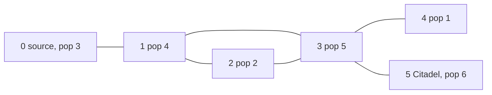
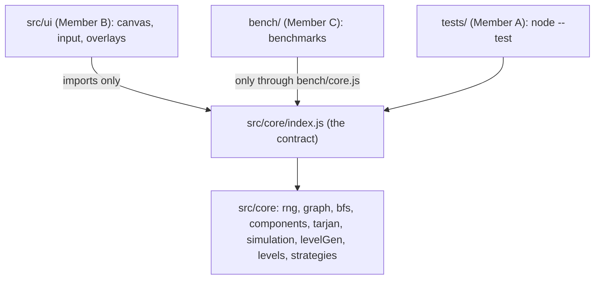

# Frostveil - Design

Course: Design & Analysis of Algorithms (EF234405), Quiz 2 group project.
Author of this document: Member C (Dzakwan Ghonim Fath'Han Mubina).

> Status note: sections 5 (Articulation-Aware Greedy) and 6 (its complexity row) are drafts. They must be
> synchronised with Member A's `docs/ALGORITHMS.md` once it is on `main` (marked `TODO(sync ALGORITHMS.md)`).
> Every other algorithm below follows the standard textbook form and the contract in `docs/CONTRACT.md`.

## 1. Problem statement and game concept

**Frostveil** is a 2D turn-based strategy game that runs in the browser. A magical frost creeps across a
realm of snow-bound settlements connected by roads. The player is the **Warden**. Each turn the Warden lights
beacons and severs roads to stop the frost, then the frost advances exactly one step along the roads. The goal
is to save as much population as possible and to always keep the **Citadel** safe.

This is a variant of the **Firefighter Problem**: a fire (here: frost) starts at one or more vertices of a
graph, the defender protects a few vertices (or edges) per turn, and the fire spreads to all unprotected
neighbors each turn. The Firefighter Problem is NP-hard on general graphs.

Why it is a good algorithmic problem:

- The spread is a **breadth-first search** in disguise: one frost layer per turn.
- Good defensive moves are **structural**: a settlement or road whose removal disconnects the graph
  (an articulation point or bridge) can wall off a whole region at the price of one action. Finding them is
  a classic **Tarjan** computation.
- The safe regions left over after the frost stops are **connected components**.
- Because the exact problem is NP-hard, there is a real trade-off between fast **greedy heuristics** and an
  **exponential exact search** that is only feasible for small graphs. That trade-off is what the evaluation measures.

## 2. Graph model

| Concept | Model |
|---|---|
| Settlement (village, town, Citadel) | node `id` in `0..n-1`, with position `x, y` in [0, 1] |
| Road | undirected, unweighted edge (frost spreads along it; it can be severed) |
| Weight | `population`, an integer from 1 to 9, stored on the node (not on the edge) |
| Node state | `CLEAR` (0), `FROSTED` (1), `WARDED` (2) |
| Special nodes | exactly one `isCitadel` node per level; 1 to 3 source nodes start `FROSTED` |

Edge geometry (euclidean length) is used only by the level generator, where Kruskal builds the network from the
shortest roads. The game itself treats roads as unweighted.

### Worked example

A level with 6 settlements, `k = 1` action per turn and a target of 50 percent saved. Node 0 is the frost
source, node 5 is the Citadel. Total population = 3 + 4 + 2 + 5 + 1 + 6 = 21.



ASCII version of the same graph:

```
  (0)--(1)--(3)--(5)   0: source, pop 3     3: pop 5
        \   / \        1: pop 4             4: pop 1
         (2)   (4)     2: pop 2             5: Citadel, pop 6
```

Structure found by Tarjan: articulation points = {1, 3}; bridges = (0,1), (3,4), (3,5). Edges (1,2), (1,3),
(2,3) form a cycle, so none of them is a bridge.

| Scenario | Turn 1 Warden phase | Frost phase | Result |
|---|---|---|---|
| Do nothing | no action | frost reaches 1 | turn 2: frost reaches 2 and 3; turn 3: frost reaches 4 and 5. Citadel frosted: **lose** (saved 0) |
| Beacon on node 1 | node 1 becomes `WARDED` | node 0 has no `CLEAR` neighbor, so nothing spreads | game over (contained). Saved = 21 - 3 = 18, which is 85.7 percent, Citadel safe: **win** |

The beacon on node 1 works because node 1 is an articulation point separating the source from the rest of the
graph. This is exactly the kind of move the Articulation-Aware Greedy strategy looks for.

## 3. Game rules (summary)

- **Turn = two phases.**
  1. *Warden phase.* The player has `k` actions (k = 1 or 2 depending on level). An action is either
     **Light Beacon** on a `CLEAR` node (it becomes `WARDED`: it can never be frosted and never transmits frost)
     or **Sever Road** on an existing edge (the edge is removed). Actions can be undone, in reverse order, until
     the phase is ended.
  2. *Frost phase* (`endWardenPhase`). Every `FROSTED` node infects all of its `CLEAR` neighbors along remaining
     edges. This is exactly one BFS layer. Newly frosted nodes do not spread further until the next turn.
- **Initial state.** 1 to 3 source nodes start `FROSTED`. The first Warden phase happens before the first frost phase.
- **Containment (game over).** No `FROSTED` node has a `CLEAR` neighbor along remaining edges, or no `CLEAR` node is left.
- **Saved population** = total population of nodes that are not `FROSTED` (warded nodes count as saved).
- **Win.** At game over, the Citadel is not frosted and saved percent >= the level's `targetPercent`. Otherwise lose.
- **Stars.** 0 if lost; 1 = win; 2 = win with saved population >= what Articulation-Aware Greedy saves on the same
  level; 3 = win with saved population >= 95 percent of the best known result (brute-force optimum when n <= 20,
  otherwise the best built-in strategy).
- **Determinism.** All randomness comes from the seeded PRNG `mulberry32`. Same seed means same level and same result.

The 8 built-in levels (seed, size, `k`, number of frost sources, target percent) are listed in the contract
(`docs/CONTRACT.md`, section "Levels"). Free Play calls `generateLevel` directly.

## 4. Algorithm choice and justification

| Algorithm | Role in Frostveil | Why this one |
|---|---|---|
| **BFS** (single and multi-source) | Frost spread, one layer per turn; frost arrival times for the Frost Forecast overlay | The frost rule ("every frosted node infects all clear neighbors") is by definition one BFS layer, so the simulation is BFS with the warded nodes and severed edges excluded. Multi-source BFS gives the arrival time of every node in O(V + E), which is the Forecast overlay. |
| **DFS / connected components** (iterative) | Safe Zones: regions of `CLEAR` nodes cut off by frosted or warded nodes, with their saved population | A region is a connected component of the graph induced by `CLEAR` nodes. One linear pass labels all components and their sizes; DFS and BFS are equally good here, and iterative DFS keeps the same code usable on 50,000+ node benchmark graphs. |
| **Tarjan articulation points and bridges** (iterative) | Critical settlements and roads; the in-game Hint; the greedy strategy | The best single action is usually a chokepoint: a node or road whose removal disconnects the graph. Tarjan finds all of them in one O(V + E) DFS, far cheaper than testing every node by deleting it and recounting components (O(V * (V + E))). |
| **Kruskal MST with union-find** (level generator) | Guarantees a connected road network made of short roads | Spanning-tree edges give connectivity (a level with an unreachable region would be meaningless); choosing the shortest edges gives a plausible map without long crossing roads. Extra short edges are then added on top to reach the target average degree. |
| **Greedy strategies** (Random, Max-Degree, Articulation-Aware) | Baselines and the Hint | Cheap, deterministic (or seeded) policies that a player can also reason about. Random is a floor, Max-Degree is the naive structural heuristic, Articulation-Aware uses the Tarjan result. Comparing them is the core of the evaluation. |
| **Brute-force search with pruning** | Exact optimum for n <= 20, used in the evaluation and for the 3-star threshold | Gives ground truth to measure the optimality gap of the heuristics. Exponential, so it is only run on small graphs; its scaling is itself an experiment (NP-hardness motivates the heuristics). |

DFS and Tarjan are **iterative** (explicit stack) because the benchmark graphs reach 50,000+ nodes, where
recursion would overflow the call stack.

## 5. Pseudocode

Conventions: `blocked` is an optional array (1 = node cannot be entered); `adj[u]` is the neighbor list of `u`.

### 5.1 BFS layers (multi-source)

```
function bfsLayers(graph, sources, blocked):
    dist <- array of size n filled with -1
    layers <- []
    frontier <- []
    for s in sources:
        if dist[s] = -1:                    // sources are always visited, even if blocked
            dist[s] <- 0; frontier.append(s)
    layers.append(frontier)
    while true:
        next <- []
        for u in frontier:
            for v in adj[u]:
                if dist[v] = -1 and not blocked[v]:
                    dist[v] <- dist[u] + 1
                    next.append(v)
        if next is empty: break
        layers.append(next); frontier <- next
    return dist, layers                      // order = layers concatenated
```

### 5.2 Connected components (iterative DFS)

```
function connectedComponents(graph, blocked):
    compId <- array of size n filled with -1; count <- 0; sizes <- []
    for r in 0 .. n-1:
        if compId[r] = -1 and not blocked[r]:
            stack <- [r]; compId[r] <- count; size <- 0
            while stack is not empty:
                u <- stack.pop(); size <- size + 1
                for v in adj[u]:
                    if compId[v] = -1 and not blocked[v]:
                        compId[v] <- count; stack.push(v)
            sizes.append(size); count <- count + 1
    return compId, count, sizes
```

### 5.3 Tarjan articulation points and bridges (iterative)

```
function articulationPointsAndBridges(graph, blocked):
    disc <- array of -1; low <- array; parent <- array of -1; next <- array of 0   // next[u] = index into adj[u]
    time <- 0; points <- {}; bridges <- []
    for r in 0 .. n-1:
        if disc[r] != -1 or blocked[r]: continue
        stack <- [r]; disc[r] <- low[r] <- time++; rootChildren <- 0
        while stack is not empty:
            u <- top of stack
            if next[u] < len(adj[u]):
                v <- adj[u][next[u]++]
                if blocked[v]: continue
                if disc[v] = -1:                         // tree edge
                    parent[v] <- u; disc[v] <- low[v] <- time++
                    stack.push(v)
                    if u = r: rootChildren++
                else if v != parent[u]:                  // back edge
                    low[u] <- min(low[u], disc[v])
            else:                                        // u is finished
                stack.pop()
                p <- parent[u]
                if p != -1:
                    low[p] <- min(low[p], low[u])
                    if low[u] > disc[p]:  bridges.append((min(p,u), max(p,u)))
                    if p != r and low[u] >= disc[p]: points.add(p)
        if rootChildren > 1: points.add(r)
    return points, bridges
```

### 5.4 Kruskal with union-find (level generator)

```
function kruskal(n, candidateEdges):                 // candidateEdges sorted by euclidean length
    parent[i] <- i; size[i] <- 1
    function find(x):                                // path compression
        while parent[x] != x: parent[x] <- parent[parent[x]]; x <- parent[x]
        return x
    function union(a, b):                            // union by size
        a <- find(a); b <- find(b)
        if a = b: return false
        if size[a] < size[b]: swap(a, b)
        parent[b] <- a; size[a] <- size[a] + size[b]; return true
    tree <- []
    for (u, v) in candidateEdges:
        if union(u, v): tree.append((u, v))
            if len(tree) = n - 1: break
    return tree                                      // spanning tree of the shortest roads
```

### 5.5 Articulation-Aware Greedy (DRAFT, `TODO(sync ALGORITHMS.md)`)

The contract only fixes the signature (`articulationGreedyStrategy(state, rng?) -> Action[]`, beacons only, never
mutates `state`) and that it uses the Tarjan result. The pseudocode below is the intended shape; replace it with
Member A's final definition.

```
function articulationGreedy(state):
    actions <- []
    blocked <- copy of blockedMask(state)            // FROSTED and WARDED nodes
    repeat state.actionsLeft times:
        points <- Tarjan(state.graph, blocked).points
        eta <- frost arrival times (BFS from FROSTED nodes, WARDED nodes blocked)
        candidates <- CLEAR nodes the frost can still reach          // eta >= 1
        choose c in candidates that maximises the population cut off from the frost,
               preferring articulation points, ties broken by population then id
        blocked[c] <- 1; actions.append(beacon on c)
    return actions
```

## 6. Complexity analysis

V = number of nodes, E = number of edges, a = actions per turn, T = number of turns.

| Algorithm | Time | Space (extra) | Notes |
|---|---|---|---|
| BFS layers | O(V + E) | O(V) | each node enters the queue once, each adjacency list is scanned once |
| Connected components (iterative DFS) | O(V + E) | O(V) | explicit stack of size at most V |
| Tarjan, iterative | O(V + E) | O(V) | arrays `disc`, `low`, `parent`, `next` plus an explicit stack |
| Union-find (find / union) | amortized O(alpha(V)) per operation | O(V) | path compression and union by size |
| Kruskal | O(E log E) (sorting) + O(E alpha(V)) | O(V + E) | in the generator the candidate set is the short-edge set |
| One frost phase (`endWardenPhase`) | O(V + E) in the worst case | O(V) | one BFS layer |
| Random strategy | O(V) per action | O(V) | pick a random `CLEAR` node |
| Max-Degree strategy | O(V) per action | O(V) | scan for the largest degree |
| Articulation-Aware Greedy | `TODO(sync ALGORITHMS.md)` | `TODO(sync ALGORITHMS.md)` | at least one Tarjan call, O(V + E), per turn |
| Brute force (beacons only, memoised) | exponential: at most 3^n distinct node-state vectors | O(3^n) in the worst case | NP-hard problem, practical only for n <= 20 |

Short correctness arguments:

- **BFS.** By induction on d, `layers[d]` contains exactly the unblocked nodes at shortest-path distance d from the
  sources. A frost phase therefore equals one layer, and the frost arrival time of a node equals its BFS distance
  in the graph where warded nodes and severed edges are removed.
- **Components.** Every node is labeled exactly once. Two unblocked nodes receive the same label if and only if
  there is a path between them that uses only unblocked nodes, because the stack explores all of a node's
  unblocked neighbors before the search for the next root begins.
- **Tarjan.** `low[u]` is the smallest discovery time reachable from the subtree of `u` using tree edges and at
  most one back edge. A non-root node `p` is an articulation point iff some child `u` has `low[u] >= disc[p]`
  (the subtree of `u` cannot reach above `p`). The root is an articulation point iff it has at least two DFS
  children. A tree edge `(p, u)` is a bridge iff `low[u] > disc[p]`. The iterative version performs the same
  operations in the same order as the recursive one; the explicit stack replaces the call stack.
- **Kruskal.** By the cut property, repeatedly adding the lightest edge that joins two different components yields
  a minimum spanning tree, which is connected by construction. Hence every generated level is connected.
- **Brute force.** Exhaustive search over all beacon placements per turn, with memoisation on the node-state
  vector, returns the maximum saved population reachable by beacon-only play, so it is an exact reference for
  that move set.

## 7. Data structures

| Structure | Used for | Why |
|---|---|---|
| Adjacency list (array of neighbor arrays) in `Graph` | all graph algorithms | O(deg) neighbor scans, O(V + E) memory, suits sparse graphs |
| Typed arrays (`Int32Array`, `Uint8Array`) | `dist`, `order`, `compId`, `blocked`, `nodeState` | compact, cache friendly, no per-element object overhead on 50,000+ nodes |
| Explicit stack (typed array) | iterative DFS and Tarjan | removes the recursion-depth limit |
| Frontier arrays / queue as typed array | BFS | O(1) push and pop, produces the layers directly |
| Union-find (`parent`, `size` arrays) | Kruskal in the level generator | near-constant amortized operations |
| `Set` of node ids, list of `[u, v]` pairs | Tarjan output | small outputs relative to V |
| Seeded `mulberry32` closure | levels, Random strategy, benchmarks | reproducibility |

## 8. Architecture



Rules that keep the three parts independent:

- `src/core` is **pure logic**. It never touches `window`, `document` or the canvas and never imports from `src/ui`.
- The UI and the benchmarks import the core **only through `src/core/index.js`**. The list of exports in
  `docs/CONTRACT.md` is the boundary between the three members' work.
- In `bench/`, only `bench/core.js` imports the core; every other benchmark file imports `./core.js`, so switching
  between a stand-in core and the real one is a one-line change.
- Vanilla JavaScript (ES modules), no framework, no bundler, no runtime dependencies, relative import paths only so
  the game works from a GitHub Pages sub-path.

## 9. Assumptions and design decisions

1. **Contract is authoritative.** Signatures and semantics in `docs/CONTRACT.md` are used as written.
2. **Unweighted spread.** Roads have no travel cost; the only weight is the population of a node. Weighted costs
   are listed as future work.
3. **Undirected roads.** Frost spreads both ways along a road.
4. **Beacon-only strategies.** The built-in strategies and the brute force return beacon actions only; road
   severing is available to the human player but not to the strategies. This is stated as a limitation in the evaluation.
5. **Benchmark graph model.** Runtime benchmarks use their own random connected sparse graphs (random spanning tree
   plus random extra edges, average degree about 6) so they do not depend on the level generator. Level-like graphs
   (average degree 3.2) are used only for the full-game and strategy experiments.
6. **Reproducibility.** Everything random is seeded; the seeds are recorded in `bench/results/environment.json`.
7. **Only real numbers.** Every number in the evaluation and the report is copied from a run recorded in
   `bench/results/`; nothing is estimated by hand.
8. **Language.** All in-game text and all documentation are in English.
