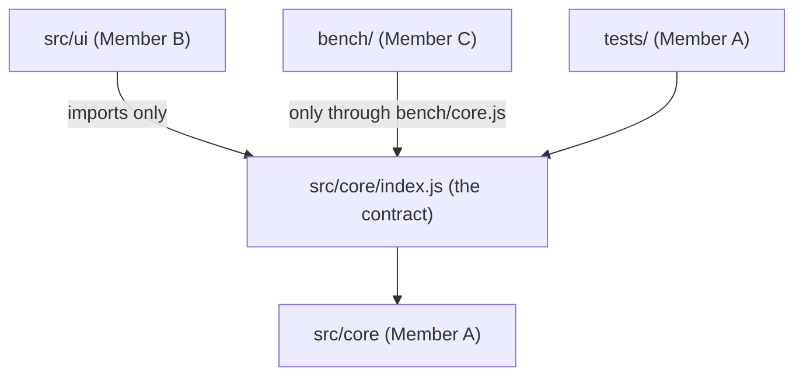

# Frostveil - Project Report

Course: Design & Analysis of Algorithms (EF234405), Quiz 2 group project.

Team: Achmad Mirza Arzheta Rahman (A), Farrel Aryasatya Raharjo (B), Dzakwan Ghonim Fath'Han Mubina (C).

> **Draft status.** Parts marked `TODO(real numbers)` must be filled from the real benchmark run (see
> `docs/EVALUATION.md`, section 7). Delete this note when everything is filled.

## 1. Introduction

Frostveil is a 2D turn-based strategy game that runs in the browser. A magical frost spreads along the roads of a
network of settlements. The player, the Warden, lights beacons and severs roads to stop the frost, then the frost
advances one step. The goal is to save as much population as possible and to keep the Citadel safe.

The game is a variant of the **Firefighter Problem**, which is NP-hard on general graphs. That makes it a good
vehicle for the course: the frost spread is a BFS, the best defensive moves are graph chokepoints found with
Tarjan's algorithm, the safe regions are connected components, and the gap between fast heuristics and an exact
exponential search can be measured. The project implements and evaluates BFS, iterative DFS (connected components),
iterative Tarjan (articulation points and bridges), Kruskal with union-find, greedy strategies and brute-force search.

## 2. Design

Full version: [DESIGN.md](DESIGN.md).

**Graph model.** A node is a settlement with a population from 1 to 9 and a position in the unit square; an edge is an
undirected road. Each node is `CLEAR`, `FROSTED` or `WARDED`. Exactly one node is the Citadel; 1 to 3 nodes start frosted.

**Rules.** A turn has a Warden phase (`k` actions of Light Beacon or Sever Road, with undo) followed by a frost phase
in which every frosted node infects all of its clear neighbors, exactly one BFS layer. The game ends when the frost
cannot spread any more. Saved population counts every node that is not frosted. The player wins if the Citadel is
safe and the saved percentage reaches the target of the level; stars compare the result with the Articulation-Aware
Greedy strategy and with the best known result.

**Algorithms.**

| Algorithm | Used for | Time |
|---|---|---|
| BFS (single and multi-source) | frost spread; frost arrival times (Forecast overlay) | O(V + E) |
| Iterative DFS / connected components | Safe Zones | O(V + E) |
| Iterative Tarjan | critical settlements and roads; Hint; greedy strategy | O(V + E) |
| Kruskal with union-find | connected road network in the level generator | O(E log E) |
| Greedy strategies (Random, Max-Degree, Articulation-Aware) | baselines and in-game Hint | see DESIGN.md |
| Brute-force search | exact optimum for n <= 20 | exponential |

DFS and Tarjan are iterative with an explicit stack, because benchmark graphs reach 50,000 or more nodes and
recursion would overflow the call stack.

**Architecture.**



`src/core` is pure logic (no `window`, `document` or canvas, and it never imports from `src/ui`). The API contract
in [CONTRACT.md](CONTRACT.md) is the boundary between the three parts.

## 3. Implementation

The work was split by file ownership so the three parts could be built in parallel and merged through pull
requests (details and checkpoints in [../TASKS.md](../TASKS.md)).

| Part | Owner | Files |
|---|---|---|
| Core logic | Member A | [rng.js](../src/core/rng.js), [graph.js](../src/core/graph.js), [bfs.js](../src/core/bfs.js), [components.js](../src/core/components.js), [tarjan.js](../src/core/tarjan.js), [simulation.js](../src/core/simulation.js), [levelGen.js](../src/core/levelGen.js), [levels.js](../src/core/levels.js), [strategies.js](../src/core/strategies.js), [index.js](../src/core/index.js); tests in [tests/](../tests/) |
| Game and UI | Member B | [index.html](../index.html), [css/](../css/), [src/ui/](../src/ui/), [UI_NOTES.md](UI_NOTES.md) |
| Evaluation and documentation | Member C | [bench/](../bench/) ([run.js](../bench/run.js), [suite.js](../bench/suite.js), [bench.html](../bench/bench.html)), [README.md](../README.md), [TASKS.md](../TASKS.md), DESIGN.md, EVALUATION.md, REPORT.md |

**How the UI uses the algorithms.**

- The **Frost Forecast** overlay calls `frostForecast`, a multi-source BFS that gives each node its frost arrival time.
- The **Safe Zones** overlay calls `safeZones`, which labels connected components of clear nodes and sums their population.
- The **Hint** calls `articulationGreedyStrategy`, which uses the Tarjan articulation points; critical settlements and
  roads come from `articulationPointsAndBridges`.
- Each turn ends with `endWardenPhase`, which advances the frost by one BFS layer; `evaluateOutcome` computes saved
  population, win/lose and stars (using the reference scores of the strategies and the brute force).
- Levels come from `generateLevel`, where Kruskal with union-find guarantees a connected road network.

**Benchmarks.** `bench/run.js` runs the three experiments with seeded inputs and writes CSV, JSON and SVG files to
`bench/results/`; `bench/bench.html` runs a lighter version in the browser with hand-written canvas charts. Only
`bench/core.js` imports the core.

## 4. Evaluation

Full version: [EVALUATION.md](EVALUATION.md). All numbers come from `bench/results/`, produced on the real core.

**Setup.** `TODO(real numbers)`: machine, Node.js version and run duration (from `bench/results/environment.json`).
Runtime: 3 warm-up and 10 timed runs per (algorithm, V), V = 50 to 50,000 (and 200,000 for the linear algorithms),
random connected sparse graphs with E about 3V. Strategies: 100 seeded levels per configuration
(n in {15, 30, 60}, k in {1, 2}), Random averaged over 20 playouts per level, brute-force reference for n = 15.

**Runtime.** `TODO(real numbers)`: key table (median, IQR, ns per element, log-log slope per algorithm).


**Strategies and optimality gap.** `TODO(real numbers)`: key table (mean saved percent, win rate, Citadel survival per
strategy and configuration; approximation ratio for n = 15).


**Brute-force scaling.** `TODO(real numbers)`: growth per extra node and the n where the time limit starts to bind.


## 5. Conclusion

`TODO(real numbers)`: write about 5 lines, each tied to a number from section 4. Planned content:

1. The linear algorithms (BFS, components, Tarjan) scale as O(V + E): log-log slopes of `TODO` to `TODO`, and the
   iterative Tarjan finished on the path-like graph of `TODO` nodes.
2. Articulation-Aware Greedy saves `TODO` percent on average against `TODO` for Max-Degree and `TODO` for Random.
3. Against the brute-force optimum at n = 15, its mean approximation ratio is `TODO` and it is optimal on `TODO`
   percent of the levels.
4. Brute-force time grows by about `TODO` per extra node, which supports using heuristics (the problem is NP-hard).
5. Limitations and future work: random graph model, one machine, beacon-only strategies; weighted costs, directed
   spread, Dijkstra-based travel and more levels.

## 6. Team contributions

The table below is the same as in [../TASKS.md](../TASKS.md).

| Member | Name | Track | Main contributions | Commit prefixes |
|---|---|---|---|---|
| A | Achmad Mirza Arzheta Rahman | Algorithms and core logic | graph algorithms (BFS, components, Tarjan), simulation, level generator (Kruskal), strategies and brute force, tests, CI, contract and algorithm docs | `core:`, `test:`, `chore:` |
| B | Farrel Aryasatya Raharjo | Game and UI | canvas game, actions and undo, Frost Forecast and Safe Zones overlays, Hint, level select and Free Play, result screen, UI notes | `ui:` |
| C | Dzakwan Ghonim Fath'Han Mubina | Evaluation and documentation | benchmark harness, runtime / strategy / brute-force experiments, charts, in-browser benchmark, Design, Evaluation and Report documents, README and task list | `bench:`, `docs:` |

## 7. How to run

```
npm run serve        # then open http://localhost:8080
npm test             # unit tests
npm run bench        # full benchmark run, writes bench/results/
```

The in-browser benchmark is at `http://localhost:8080/bench/bench.html` after `npm run serve`.
More commands: [README.md](../README.md) and [EVALUATION.md](EVALUATION.md), section 7.

## 8. GitHub Pages

Playable game: `https://<user>.github.io/<repo>/` (replace with the real link after Pages is enabled).
