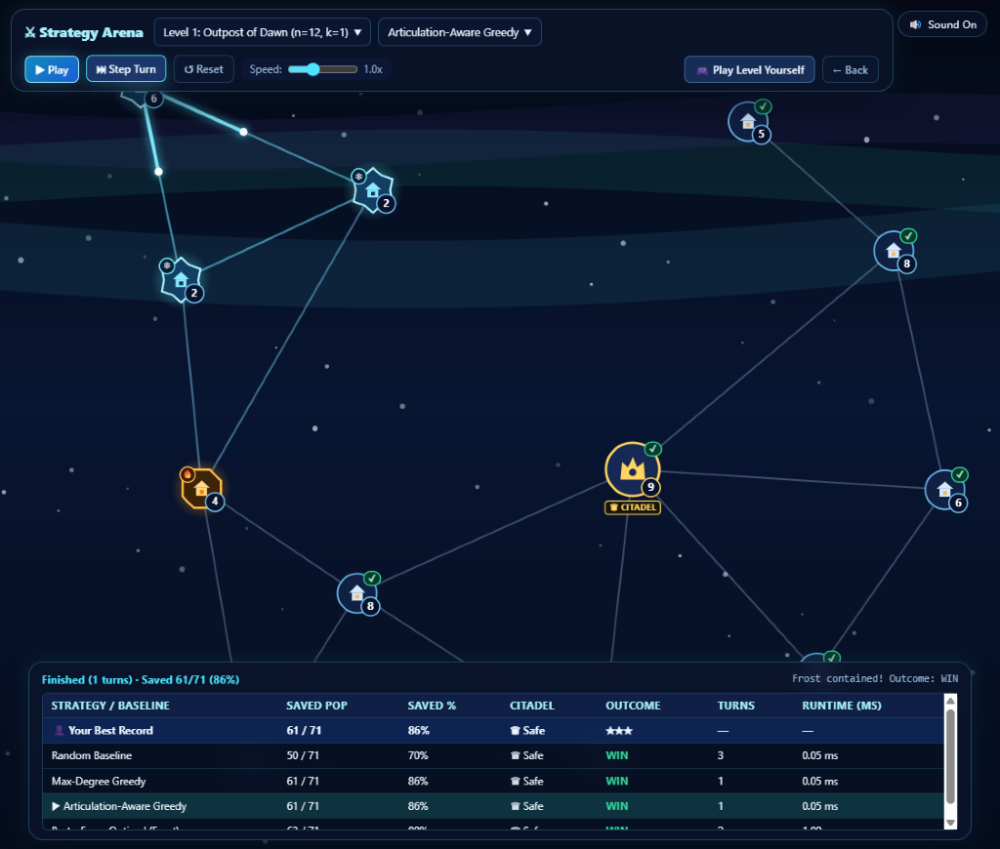

# Frostveil — Game & UI Layer Notes (Member B: Farrel Aryasatya Raharjo)

## 1. Overview & File Ownership

This document describes the architecture, assumptions, verification steps, and core-integration procedure for the **Game and UI track (Member B)** of **Frostveil** (*Design & Analysis of Algorithms — EF234405*).

Only files owned by Member B were created or modified on branch `feature/ui`:

```text
index.html
css/style.css
src/ui/
├── main.js          # Application bootstrap, 60fps render loop, game controller, Arena playback
├── screens.js       # Screen router (Title, Level Select, Free Play, Result, How to Play, Strategy Arena)
├── renderer.js      # Procedural HTML5 Canvas 2D drawing for settlements, Citadel, roads, and overlays
├── layout.js        # Responsive [0,1] coordinate scaling, HUD safe margins, node/edge hit-testing
├── input.js         # Mouse, touch (including long-press inspection tooltip), and keyboard shortcuts
├── hud.js           # Turn/action counters, progress bar with target marker, tooltip, toast, ARIA live status
├── effects.js       # Aurora borealis ribbons, falling snow pool, frost creep, severed-road ghost, beacon pulse
├── audio.js         # Pure Web Audio API synthesized sound effects + persisted mute toggle
├── storage.js       # Safe try/catch localStorage wrapper for level stars, unlocks, and demo toggle
├── core.js          # Single import bridge between the UI and the core engine
└── mockCore.js      # Temporary contract-compliant stand-in while Member A's checkpoints are pending
docs/
├── UI_NOTES.md      # This document
└── img/
    └── strategy-arena.png
```

---

## 2. How to Run Locally

Because Frostveil uses native ES modules (`<script type="module" src="./src/ui/main.js">`), it must be served over HTTP rather than opened via `file://`:

```bash
# Option 1: Python 3 built-in HTTP server
python -m http.server 8080

# Option 2: Once Member A's package.json lands on main
npm run serve
```

Then open `http://localhost:8080/` (or any sub-path such as `http://localhost:8080/frostveil/` — all paths use relative `./` references for GitHub Pages compatibility).

---

## 3. Screens & Features Built

1. **Title Screen (`#screen-title`)**:
   - Frosted glow title typography (`FROSTVEIL`), animated arctic night backdrop with aurora borealis bands, slow falling snow, and live procedural graph preview.
   - Direct navigation to **Play Game**, **Strategy Arena**, and **How to Play**.
2. **Level Select & Free Play Screen (`#screen-levels`)**:
   - **8 Campaign Levels** (`IDs 1..8`) displaying level name, node count (`n`), actions per turn (`k`), initial frost sources, target saved percentage, earned stars (`0..3`), and best saved record.
   - Progressive level locking (Level `N+1` unlocks upon winning Level `N`) plus an **"Unlock All Levels (Demo)"** checkbox toggle in the header for grading and demonstrations.
   - **Free Play Generator** card with sliders for `n` (`10..80`), `k` (`1..3`), frost sources (`1..3`), target saved percentage (`35%..85%`, default `60%`), deterministic seed input, and a **Random Seed** button.
3. **Interactive Game Screen (`#screen-game`)**:
   - Responsive full-viewport HTML5 Canvas 2D supporting crisp `devicePixelRatio` scaling.
   - **Warden Tools**: **Auto** (click node = Light Beacon, click edge = Sever Road), **Beacon (`1`)**, and **Sever (`2`)**.
   - **Algorithmic Overlays**:
     - **Forecast (`F`)**: Calls `frostForecast(state)` (multi-source BFS) and renders arrival turn badges (`1t`, `2t`, ...) on every `CLEAR` settlement or `✓` when unreachable (`-1`).
     - **Safe Zones (`Z`)**: Calls `safeZones(state)` (iterative DFS connected components) and tints each zone with its total population and a distinct `✓ SECURED` emerald shield when `threatened === false`.
     - **Critical (`C`)**: Calls `articulationPointsAndBridges(state.graph, blockedMask(state))` (iterative Tarjan) and outlines critical articulation settlements with dashed magenta rings (`◆`) while highlighting bridge roads.
   - **Hint (`H`)**: Limited to 3 per level; calls `articulationGreedyStrategy(state)` without mutating state or spending an action, highlighting suggested settlement(s) with a pulsing double ring.
   - **Turn Controls**: **Undo (`U`)**, **End Turn (`E`)**, **Restart (`R`)**, and **Menu (`Esc`)**.
4. **Result Screen (`#screen-result`)**:
   - Displays Victory/Defeat banner, earned stars (`★` to `★★★`), Saved Population vs Target, Citadel status, and Turns taken.
   - **Algorithm Benchmark Table**: Runs `playOut` for every entry in `STRATEGIES` (`Random`, `Max-Degree`, `Articulation-Aware Greedy`) plus `bruteForceOptimal` (when `n <= 20`) on the exact same level to compare against the player's run.
5. **How to Play Screen (`#screen-howto`)**:
   - Illustrated rules with 4 procedurally drawn mini-canvases covering Settlements & The Citadel, Warden Phase Actions (Beacon & Sever Road), Frost Spread (1 BFS layer per turn), Overlays/Stars, and the full keyboard shortcut reference.
6. **Strategy Arena Screen (`#screen-arena`)**:
   - Select any level and watch any strategy (`Random`, `Max-Degree`, `Articulation-Aware Greedy`, or `Brute-Force Optimal` for `n <= 20`) play out automatically turn by turn with **Play/Pause**, **Step Turn**, **Reset**, and a **Speed slider**.
   - Displays a side-by-side comparison table with Saved Population, Saved %, Citadel status, Win/Lose outcome, Turns, and Runtime in milliseconds (`ms`).



---

## 4. Current Core Status & Switching to Member A's Real Core

At the time of building `feature/ui`, `main` contained only the initial `README.md` (Member A's checkpoints CP0–CP3 had not yet been pushed to `origin`).

Following Section 12 (*Working before the core exists*):
- Every UI file imports core symbols **exclusively** through `src/ui/core.js`.
- `src/ui/core.js` currently re-exports `./mockCore.js`, which implements the exact signatures and semantics of Section 6 (*THE CONTRACT*).
- **To switch to Member A's real core once CP1–CP3 land on `main`**:
  1. Edit `src/ui/core.js` to replace `export * from './mockCore.js';` with `export * from '../core/index.js';`.
  2. Delete `src/ui/mockCore.js`.

---

## 5. Recorded Assumptions & Accessibility Notes

- **Strictly Zero UI Game Logic**: The UI never computes frost spread, BFS arrival times, connected components, articulation points, or win/star evaluation itself; all calculations are delegated to the contract functions exported by `src/ui/core.js`.
- **Accessibility**:
  - Node states are distinguished by **shape, icon, and color**: `CLEAR` nodes are circular huts, `FROSTED` nodes use a 12-vertex jagged ice crystal silhouette with a `❄` badge, `WARDED` nodes use an octagon frame with a `🔥` badge and amber glow, and the `Citadel` is larger with a procedural crown spire (`♛ CITADEL`).
  - `prefers-reduced-motion: reduce` disables falling snow, aurora wave motion, and transient edge/node animations.
  - All interactive controls are native `<button>`, `<input>`, or `<select>` elements with high-contrast `:focus-visible` outlines, and `#aria-status` (`aria-live="polite"`) announces turn progression and outcomes.
- **Known Issues**: None. Verified over HTTP (`http://localhost:8123/`) across all 6 screens with zero console errors and steady 60 FPS rendering.
